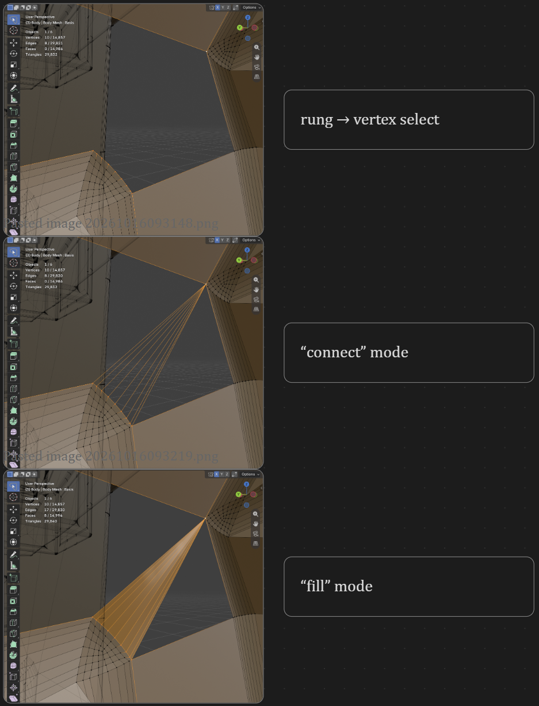
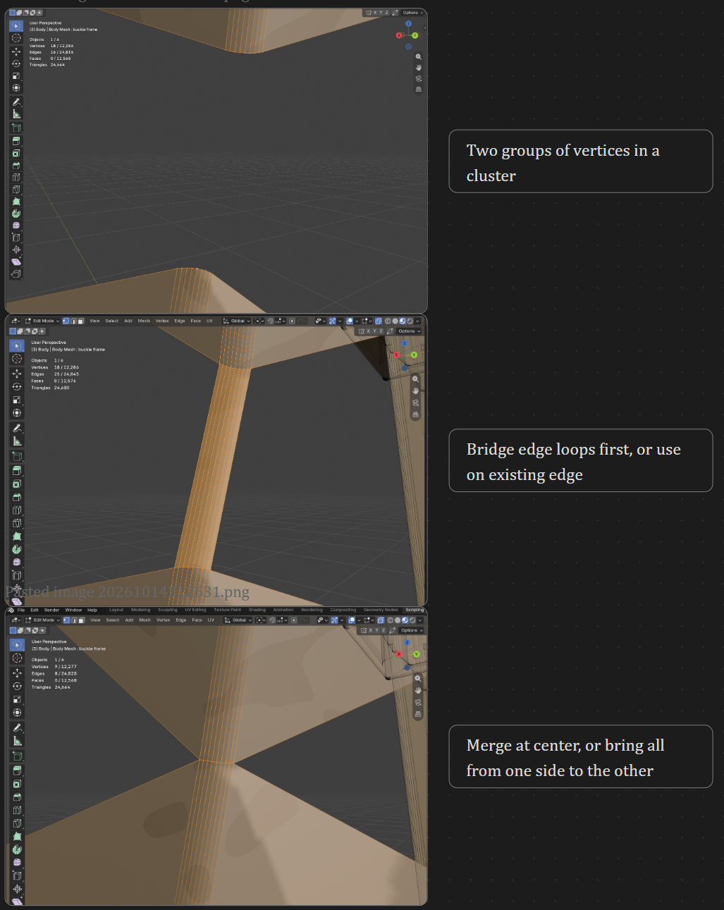
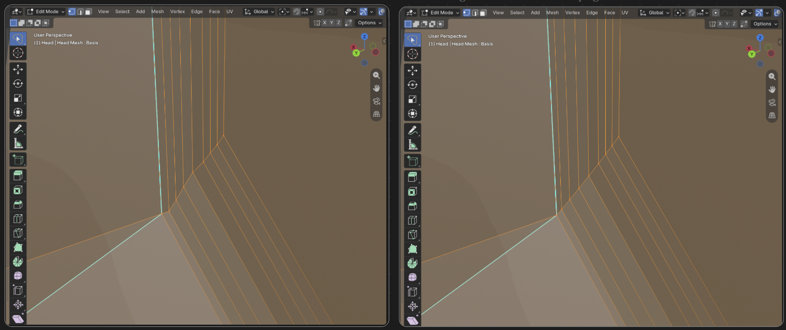
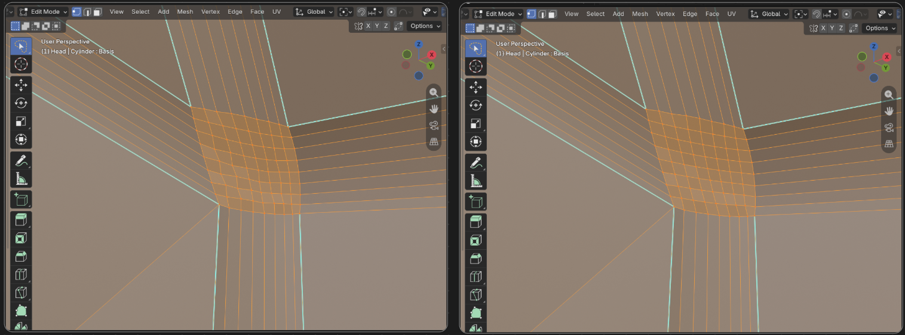

# Blender-Script-Suite
Scripts I have developed to help with various problems in Blender that don't have good solutions already built into the program

## Brief descriptions of the listed scripts
Find the script that you need for your problem easier

### keys_promote_to_basis
- You modelled on a shape key instead of Basis by accident? Make that shape the new Basis without losing any other key.
- IMPORTANT: only use this if you are okay with re-modeling the key you promote. All it's data will be wiped and scaling 0-1 will do nothing after running.

### vertex_fill
- connect several verts to ONE vertex (join or fill will not do this)
- fill the wedges between them in Blender's Edit Mode.

### vertex_merge_rungs
- Merge two rows of verts together, each with the one it's already connected to
- You need to run Edge -> Bridge Edge Loops first!

### vertex_smooth
- **snap a messy vertex selection onto the smooth shape that best fits it.** Least-squares smooth curve (polynomial), best-fit circle (arc), or a polynomial height field over the patch's own plane. Built in logic to help you choose which is most applicable - or experiment, and fine-tune any of the above options
- Smooth a bounded messy selection (like loop tools) to be equidistant as Blender intended
- Smooth an unbounded selection/blemish on a surface to make the area smoother more broadly

